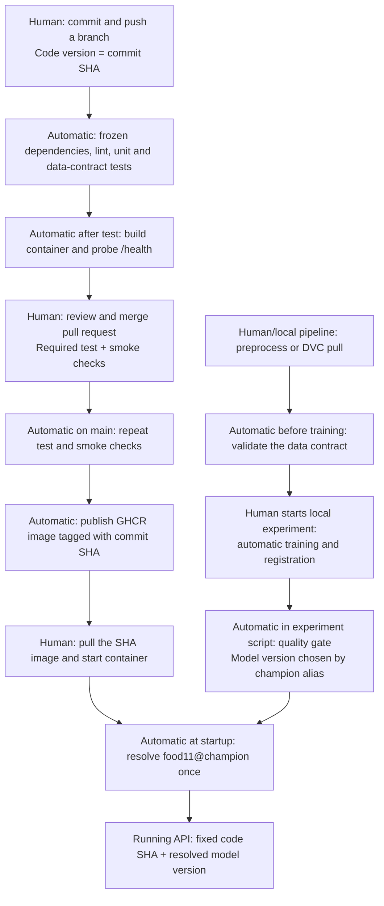

# Lab 5: CI/CD with GitHub Actions

[Lab index](../index.md) | [Instructions](instructions.md)

## Question 1: Why avoid loading the real model in unit tests?

A stopped MLflow server or unavailable network makes correct code fail. Missing credentials, a moved champion alias, deleted artifacts, and incompatible model dependencies also cause unrelated failures. A fake model makes the test deterministic and independent of training infrastructure.

## Question 2: What does the fake-model API test prove?

It checks multipart upload handling, image decoding, the training-compatible tensor shape, model invocation, class mapping, stable softmax, and the JSON response. It checks Bread and approximately 0.90 confidence using log probabilities as fake logits. It does not establish real-model accuracy, generalization, registry availability, or successful loading of actual artifacts.

## Question 3: Which check catches a copied image?

The content-hash check detects the same bytes in two splits, regardless of filename. A corrupt image causes a visible failure; leakage silently inflates evaluation accuracy and can cause an unsuitable model to pass promotion. The regression test builds a valid miniature contract, introduces a cross-split duplicate, and verifies rejection. Actual dataset validation and the duplicate experiment are recorded in the [verification report](reports/verification.md). The original 43 mini-dataset duplicates have now been removed, and both processed datasets pass the contract.

## Question 4: Where should data validation run?

Run it after preprocessing or DVC pull and before training on the machine with the data. Also run it in a data pipeline or a self-hosted CI runner with authenticated DVC access before registration/promotion. Cloud CI tests the validator against generated data without downloading the real dataset.

## Question 5: What does needs: test do?

A failed test job skips smoke, and consequently skips publishing. Without needs, smoke could run in parallel and succeed even while unit tests fail.

## Question 6: First versus second CI run

The [first run](https://github.com/marcger2004/mlops-lab-1/actions/runs/40890938161)
took **5 min 28 s**; the [second run](https://github.com/marcger2004/mlops-lab-1/actions/runs/40891417620)
took **6 min 34 s**, measured from run creation to the final job completion.

| Step | First run | Second run |
| --- | --- | --- |
| Frozen dependency sync | 4 s | 6 s |
| Pytest | 22 s | 21 s |
| Smoke Docker build | 39 s | 42 s |
| Registry build and push | 209 s | 267 s |

Only pytest was slightly faster. These measurements do not show a cache speedup.
The second run began before the first had finished publishing, so it could not
reuse the first run's completed publication cache. Runner/network variation also
matters. setup-uv caches dependencies, while the publication job uses BuildKit's
GitHub Actions cache; the smoke build has no persistent layer cache. The second
push changed documentation rather than being the exact empty-commit procedure.
The [raw timings](reports/ci-runs.json) preserve that distinction.

The handout's empty-commit procedure was also run on the protected PR branch:
commit `6628cc5` contains no file changes from `790e0b6`. The comparable push
runs took 1m32s and 1m40s, respectively. Dependency sync stayed at 5s; pytest
improved from 22s to 14s, while the uncached smoke build increased from 30s to
50s. Publishing was skipped on this branch by design. These measurements are
recorded in [the empty-commit comparison](reports/ci-empty-commit.json); they show
why a faster test step does not necessarily make the entire pipeline faster.

## Question 7: Why tag images with the commit SHA?

The SHA identifies the source revision and supports audit and rollback. With latest, machine A can retain yesterday's cached image while machine B pulls today's image, even though both configurations say latest. Use the published SHA tag when deploying; an image digest provides an even stronger content identifier.

## Question 8: Why explicit token permissions?

The publishing job needs package write access and repository read access. Other jobs receive only repository read permission. An overprivileged compromised step could modify source, releases, or repository settings within the granted scopes and publish malicious artifacts.

## Question 9: Branch protection and the deliberately failing PR

The repository now requires a pull request and passing `test` and `smoke`
checks on main, including for administrators. Required review approvals are set
to zero so this individual lab repository can merge its own passing pull request.

[Pull request #1](https://github.com/marcger2004/mlops-lab-1/pull/1) deliberately
expected RuntimeError from an invalid model accuracy, although the gate correctly
raises ValueError. `test` failed, `smoke` was skipped, and GitHub returned
`mergeable_state: blocked`. The PR had no textual merge conflict; the required
checks were what prevented merging. Correcting the expected exception retains
useful regression coverage for NaN, infinity, negative accuracy, and accuracy
above one. The [recorded checks](reports/pull-request.json) provide the evidence.

This enforces one shared policy for the team rather than depending on everyone
remembering to run local tests. Changes to required checks or bypass policy still
need repository administrator privileges.

## Question 10: Model promotion decisions

The script reads test_accuracy, follows source_run_id tags used by the earlier registration script, and computes 2*sqrt(p*(1-p)/n). It records both accuracies, the margin, metric, test size, prior champion and decision as candidate-version tags. Missing metrics fail before changing aliases.

Two real ResNet18 candidates were trained on the corrected mini dataset, each
for one epoch with seed 42 and batch size 32. The evaluation split contained
1096 images. The existing champion (version 1) had test accuracy 0.74270073.

| Candidate version | Learning rate | Test accuracy | Gate decision |
| --- | --- | --- | --- |
| 2 | 0.000001 | 0.09215328 (9.2153%) | challenger |
| 3 | 0.001 | 0.35857664 (35.8577%) | challenger |

For the champion, `2 * sqrt(0.74270073 * (1 - 0.74270073) / 1096)` is
**0.02640894**, or **2.6409 percentage points**. A candidate therefore needed
accuracy of at least **0.76910967 (76.9110%)**. Neither passed. Champion remained
version 1; challenger ended at version 3. The candidate-version tags were read
back from MLflow and captured with run IDs in the [model-gate report](reports/model-gate.json).

Reproduce the two runs and automatic gates with MLflow running and corrected data:

```powershell
uv run python scripts/run_lab5_experiment.py
```

The historical champion was trained before the duplicate cleanup. Its recorded
metric is used to reproduce the lab's specified gate; this comparison does not
certify that historical training was free of leakage. For a fresh deployment,
retrain the baseline on the corrected data. One epoch also limits candidate
quality; the gate correctly rejects a weaker candidate instead of promoting it
merely because it is newer.

## Question 11: How can promotion run automatically?

Call the script after training from a local orchestrator or a self-hosted runner that can reach MLflow. The submitted experiment script implements this: it registers each trained candidate and immediately calls the gate. Alternatively host MLflow on a reachable authenticated server (for example DagsHub) and run the promotion job with credentials stored as CI secrets. Serialize promotions to avoid two candidates racing to update champion.

## Question 12: Pipeline and version decisions




Code and model releases are independent. A running API resolves champion once;
restart/redeploy to adopt a newly promoted model. CI smoke bypasses model loading and
therefore does not certify registry connectivity.
